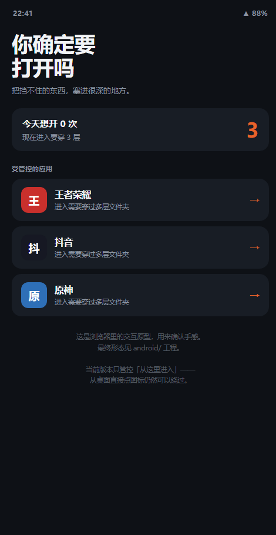
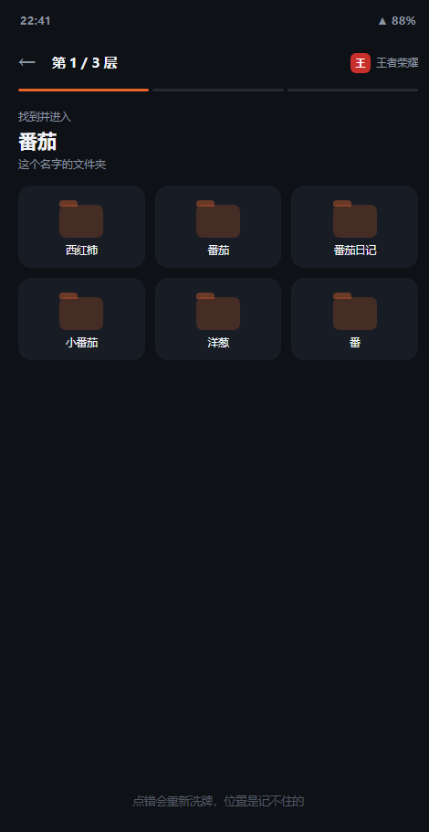
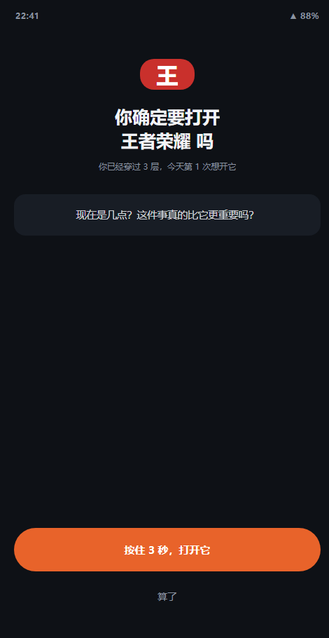

<div align="center">

# 你确定要打开吗

**把最想打开的那个 App，藏进很深的地方。**

一个用「无限层文件夹」给冲动加摩擦的 Android 小工具。<br>
不做任何禁止，只把「打开」的成本从 1 秒提高到 30 秒。






</div>

---

## 它解决什么问题

你想少玩某个游戏，靠意志力失败了第一百次。

市面上的自律工具都在做同一件事：**禁止**。然后你想办法绕过它——因为它和你的欲望是对立的。

这个工具做的是另一件事：**加摩擦**。

它不拦你，它只是把那个 App 塞进一个很深的文件夹迷宫里。你每次想打开，都必须：

- 一层一层往下点，**每一层**都要在十几个形近词里找到唯一正确的那个
- 点错就整层重新洗牌，位置记不住
- 走到最后，等 10 秒冷静倒计时，按住按钮 3 秒不松手
- 屏幕上还写着一句你自己设的问题

**它拦不住你，但它给了你 30 秒的清醒时间。** 而冲动，通常撑不过 30 秒。

> 这不是家长控制软件，也不是戒断治疗工具。它只是一个把「手指比脑子快」这个 bug 打上补丁的小玩意。

---

## 摩擦是怎么设计的

这是整个项目唯一值得看的部分。四个机制叠加，每个都有明确的设计取舍：

| 机制 | 做法 | 为什么这么设计 |
|:--|:--|:--|
| **形近词迷宫** | 口令词是「番茄」，干扰格是「番茄酱 / 小番茄 / 番茄钟 / 番 / 茄」 | 摩擦来自**视觉搜索**，不来自运气。纯随机猜谜会让人卡死，而卡死的结局不是戒断，是卸载 |
| **错误重洗** | 点错一格，整层重新打乱 | 破坏肌肉记忆。你不能靠「第三行第二个」通关，每次都得重新看 |
| **递增层数** | `层数 = 基础层数 + min(今日已试次数, 5)` | 固定难度会被**习惯化**（第三次你就麻木了），递增不会。上限 5 是为了防止某个放纵日穿 20 层然后愤怒卸载 |
| **三重终局** | 冷静倒计时 → 按住 3 秒 → 自省问题 | 冲动的时间尺度是 1 秒级的。把动作从「点一下」拉长到「持续 13 秒」，冲动自己就散了 |

**一个关键的反直觉点**：最后的「按住 3 秒」不是仪式感，是物理上让你必须保持一个动作。人在冲动时能完成一次点击，但很难完成一组持续的、需要耐心的动作。

---

## 功能

- 📁 **无限层文件夹** — 层数可调，还能随当天打开次数自动加厚
- 🔤 **口令词迷宫** — 自定义口令词，干扰项由形近词自动生成
- ⏳ **三重终局** — 冷静倒计时 / 长按解锁 / 自定义自省问题
- 📊 **今日计数** — 记录你今天想开几次，跨天自动归零
- 🎨 **单文件无依赖** — 纯 Compose，不联网、不上传、无广告、无账号

---

## 快速开始

### 方式一：先玩网页原型（30 秒，不用装任何东西）

用浏览器打开 [`prototype/index.html`](prototype/index.html)。

这是纯前端的交互原型，逻辑和 Android 版一致，用来先确认手感。觉得有意思再往下走。

> 小技巧：加 `?demo=maze` 直接跳到迷宫页，`?demo=gate` 直接看最后一关。

### 方式二：自己构建 APK

**环境要求**：JDK 17+、Android SDK Platform 35、Android Studio Ladybug 或更新。

```bash
git clone https://github.com/mikoi6/dont-open.git
cd dont-open/android

# macOS / Linux
./gradlew assembleDebug

# Windows
gradlew.bat assembleDebug
```

产物在 `app/build/outputs/apk/debug/app-debug.apk`。

用数据线连手机后也可以直接安装：

```bash
adb install -r app/build/outputs/apk/debug/app-debug.apk
```

> 首次构建前，Android Studio 会自动生成 `local.properties` 写入你的 SDK 路径；命令行构建则需要设置 `ANDROID_HOME` 环境变量。

### 方式三：用 Android Studio 打开

`File → Open` → 选择 `android/` 目录（**不是仓库根目录**）→ 等 Gradle Sync 完成 → Run。

---

## 怎么用

1. **把应用藏起来** — 首页点「＋ 把应用藏起来」，勾选你想管控的 App（游戏、短视频…）
2. **设一个口令词** — 展开「设置」，填一个你记得住的词。它会出现在每一层的迷宫里
3. **写一句自省问题** — 换成对你真正有效的，比如「你今天说要写的代码写完了吗」
4. **调摩擦强度** — 基础层数越高越难；冷静倒计时越长越难

之后每次想打开受管控的应用，都要从这个 App 里走一遍迷宫。

### 可调参数

| 参数 | 位置 | 默认值 | 说明 |
|:--|:--|:--|:--|
| 口令词 | `Config.kt` → `Store.keyword()` | `番茄` | 迷宫里的正确答案，也是唯一的提示 |
| 基础层数 | `Store.baseDepth()` | `3` | 每次要穿过的层数基数 |
| 冷静倒计时 | `Store.calmSec()` | `10` 秒 | 终局按钮解锁前的等待时间 |
| 自省问题 | `Store.reason()` | 内置一句 | 终局页显示的话，**建议自己改** |
| 每日加层上限 | `Maze.totalDepth()` | `5` | 当天想开太多次时的封顶，防止愤怒卸载 |
| 干扰词池 | `Maze.SUFFIX / PREFIX / FILLER` | 见源码 | 中文口令词效果好；英文口令词建议自己加规则 |

---

## 已知限制

> ⚠️ **最需要知道的一条：从手机桌面直接点图标，可以绕过这个工具。**

当前版本只管控「从这个 App 里进入」的路径。桌面图标还在，直接点就进去了。

这是 v1 的范围决定，不是 bug。堵住它需要用 `AccessibilityService` 监听前台窗口变化，属于 v2（见 [Roadmap](#roadmap)）。

其他限制：

- 只在 Android 8.0+（API 26）测试过，更高版本未做兼容性验证
- 应用列表需要 `QUERY_ALL_PACKAGES` 权限。若打算上架 Google Play，需改用 `<queries>` 声明并说明用途
- 图标在列表中即时加载，未做缓存，应用很多时滚动略卡
- 数据全部存在本地 `SharedPreferences`，不联网，也不备份

---

## Roadmap

- [x] v1 — 迷宫本体：形近词 + 递增层数 + 三重终局
- [ ] v2 — 桌面拦截：`AccessibilityService` 检测前台应用，把用户拉回迷宫
- [ ] v2 — 遮罩方案：用 `SYSTEM_ALERT_WINDOW` 盖住目标 App，避免「闪一下」的生硬体验
- [ ] v3 — Launcher 模式：让自己成为桌面，目标 App 图标根本不在桌面上
- [ ] 数据统计：今日次数 / 周趋势 / 放弃率
- [ ] 硬核模式：卸载需要输入一串随机字符，或由朋友设置密码

---

## 项目结构

```
dont-open/
├── android/                        # Android 工程（用 Android Studio 打开这个目录）
│   └── app/src/main/java/com/example/dontopen/
│       ├── Config.kt               # 存储 + 迷宫生成器（核心逻辑，建议先读这个）
│       ├── MainActivity.kt         # 入口 / 主题 / 两页路由
│       ├── HomeScreen.kt           # 首页：选择受管应用、调参
│       └── MazeScreen.kt           # 迷宫 + 最后一关
├── prototype/
│   ├── index.html                  # 网页交互原型（浏览器直接打开）
│   └── maze-test.js                # 迷宫算法不变量测试（node 运行）
├── docs/screenshots/               # README 配图
└── README.md
```

### 跑一下算法测试

迷宫生成器的输出必须满足 5 条不变量（每层唯一答案、干扰词绝不等于答案、干扰词不重复……）：

```bash
node prototype/maze-test.js
```

覆盖 7 种口令词 × 5 种格子数 × 200 轮随机生成。

---

## 技术栈

- **Kotlin 2.0.21** + **Jetpack Compose**（Material 3）
- 单 Activity，两个页面，用状态变量做路由，不引 Navigation 库
- 数据层只有 `SharedPreferences`，没有 Room / DataStore
- 零第三方依赖（除 AndroidX）
- 构建：AGP 8.7.3 / Gradle 8.10.2 / `compileSdk 35` / `minSdk 26`

整个 App 大约 1200 行 Kotlin，其中真正的「创意」集中在 `Config.kt` 的 `Maze` 对象里，不到 100 行。

---

## 免责声明

这是一个个人自律工具，**不能替代医疗或心理治疗**。如果你发现自己无法控制使用手机的程度并已影响正常生活，请寻求专业帮助。

本项目不对任何人因使用本工具产生的后果负责——包括但不限于「因为找不到口令词而卸载」。

---

## License

[MIT](LICENSE) © 2026 dont-open contributors

如果这个思路帮到了你，欢迎拿去改成你自己的版本。**最有效的摩擦，一定是你自己设计的那个。**
